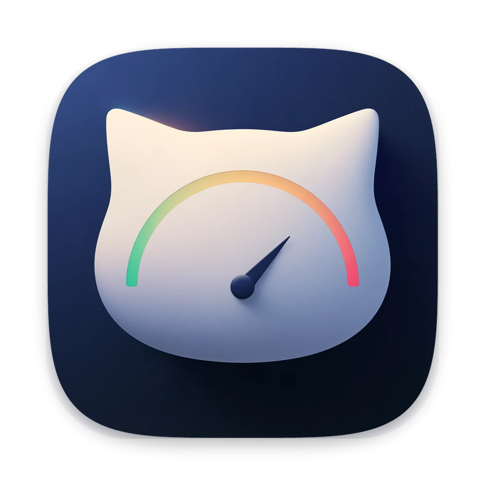
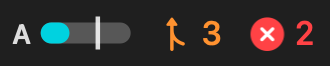
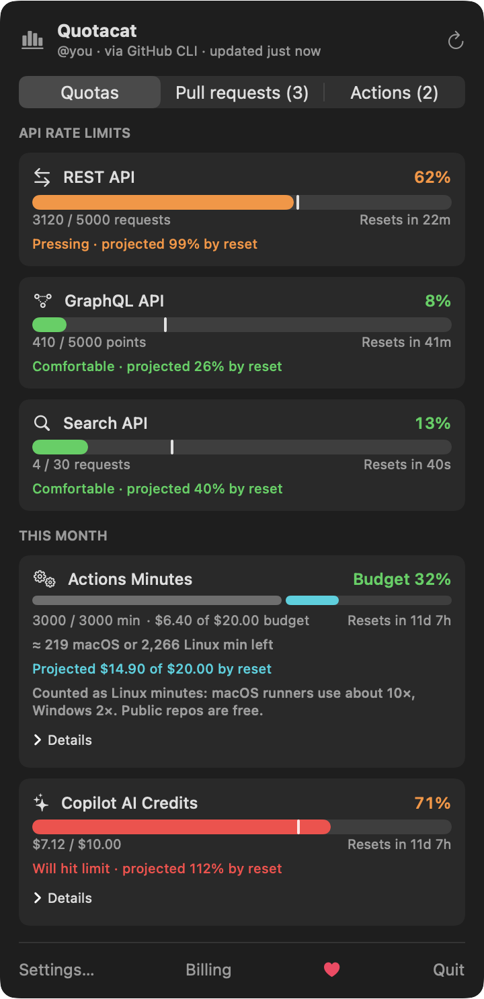
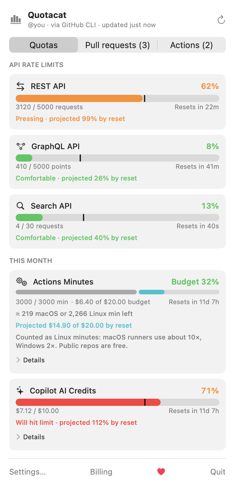
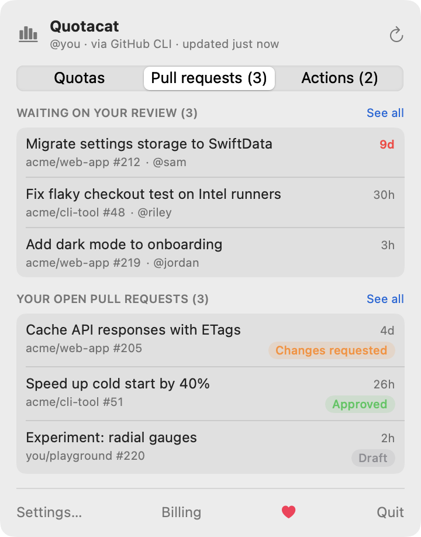
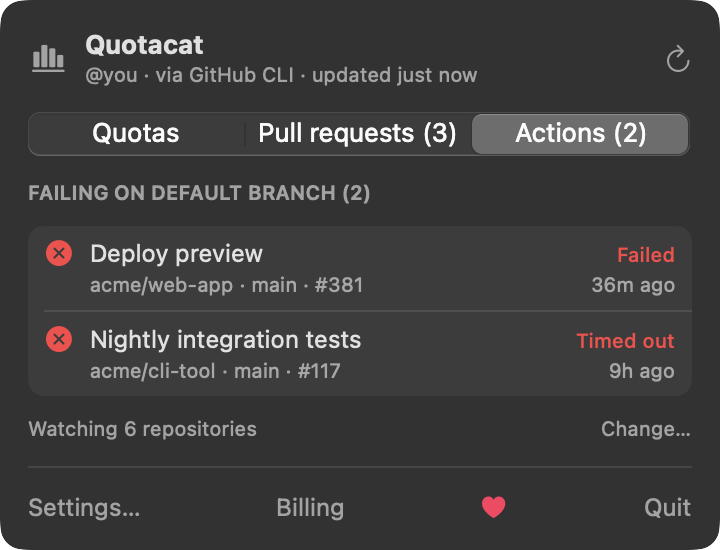

<p align="center">
  
</p>

<h1 align="center">Quotacat</h1>

<p align="center">
  Your GitHub quotas in the macOS menu bar: API rate limits, Actions minutes, Copilot AI Credits, pull requests waiting on you, and failing GitHub Actions.
</p>

<p align="center">
  <a href="https://ko-fi.com/mrte90"></a>
  
  
</p>

<p align="center">
  
</p>

<p align="center">
  
  &nbsp;
  
</p>

<p align="center">
  
  &nbsp;
  
</p>

## What it shows

| Metric | Resets |
|---|---|
| REST API rate limit | hourly |
| GraphQL API rate limit | hourly |
| Search API rate limit | every minute |
| Actions minutes, by repository | monthly (UTC) |
| Copilot AI Credits ($), by model; premium requests on annual plans | monthly (UTC) |

Each bar has a **time marker** for how far through the window you are, and a **pace projection**
that estimates where you'll be at reset: green when comfortable, through orange and red, to purple
when you're far ahead of your quota.

Also included:

- Five menu-bar styles (progress bar, battery, radial, percentage, text only), monochrome mode,
  and a "show remaining" option
- Popover meters as horizontal bars or radial rings
- **Pull requests tab:** PRs waiting on your review (oldest first, turning orange after 3 days and
  red after 7) and your own open PRs with their review status. The menu bar can show how many
  reviews are waiting on you, and you can get a notification for each new review request.
- **Actions tab:** workflows whose latest run on a repository's default branch failed, with a red
  menu-bar badge and notifications when a workflow breaks or recovers. It watches repositories you
  pushed to in the last 30 days, or the ones you pick. Unchanged repositories are checked with
  conditional requests, which don't count against your API limit.
- Notifications at 75%, 90% and 95%, and when a limit resets
- A refresh interval from 10 seconds to 5 minutes, plus refreshes on wake and when the network returns
- Daily usage charts for the month
- Launch at login
- A JSON cache file for shell prompts

## Download

**[⬇ Download Quotacat for macOS](https://github.com/mrte1122/Quotacat/releases/latest/download/Quotacat.zip)**
(macOS 14 or later, Apple silicon and Intel)

1. Unzip it and drag **Quotacat.app** into **Applications**.
2. Open it, and look for the gauges in your menu bar. Quotacat has no Dock icon.

Quotacat is signed with an Apple Developer ID and notarized by Apple, so it opens without
security warnings.

## Updates

Quotacat checks GitHub for a new release once a day and shows an **Update** button in the
popover when one is available. Updates are checked twice: each release ships an Ed25519 signature that
must match the key built into the app, and the new version must be signed by the same Apple
Developer ID. You can also check from
**Settings → General → Check for Updates**, or turn automatic checks off.

## Build from source

Requires the Swift toolchain (Xcode, or just the Command Line Tools: `xcode-select --install`).

```bash
git clone https://github.com/mrte1122/Quotacat.git
cd Quotacat
./scripts/build-app.sh --install
open ~/Applications/Quotacat.app
```

## Sign in

Quotacat reuses your [GitHub CLI](https://cli.github.com) login, so if `gh auth status` works,
you're done. Alternatively, paste a personal access token in **Settings → Account**; it's stored
in the macOS Keychain.

Rate limits work with any token. **Actions minutes and Copilot usage** come from
GitHub's billing API, which needs the `user` scope:

```bash
gh auth refresh -h github.com -s user
```

Actions minutes are counted the way GitHub bills them: in standard Linux minutes, where macOS
runners use about 10× and Windows 2×, and public repositories are free. With the `user` scope,
Quotacat reads your plan and uses its included minutes automatically. Set your Copilot plan
(Pro includes $10 of AI Credits, Pro+ $39) in **Settings → Quotas**.

**Got an Actions budget?** Enter it in **Settings → Quotas** (GitHub doesn't share personal
budgets through its API). Once your included minutes run out, the Actions card switches to the
budget: how much is spent, how many more minutes it buys on each runner type, where you'll land
by the end of the month at your recent rate, and, if your budget blocks usage, when Actions
would stop.

## Privacy

- Your token is only sent to `api.github.com`.
- The daily update check is an anonymous request for this repo's latest release; no token or
  identifier is sent, and you can turn it off in Settings.
- There is no telemetry or analytics.
- Usage data stays on your Mac, in `~/Library/Application Support/Quotacat/usage.json`.

## Shell prompt

Each refresh writes the cache file above, so a prompt can show usage without calling the API:

```bash
jq -r '.metrics[] | select(.kind=="core") | "gh \(.percent)%"' \
  ~/Library/Application\ Support/Quotacat/usage.json
```

## Command-line modes

```bash
Q=~/Applications/Quotacat.app/Contents/MacOS/Quotacat
$Q --selftest                 # run the pace and countdown math checks
$Q --once                     # fetch once and print a summary (never prints your token)
$Q --snapshot DIR [--demo]    # render the popover and icons to PNGs; --demo uses sample data
$Q --launch-at-login on|off   # same as the Settings toggle
$Q --check-update             # print the latest release version
$Q --update                   # download, verify, and install the latest release
```

## Releasing (maintainers)

One-time setup: a "Developer ID Application" certificate in your Keychain, notarization
credentials stored with `xcrun notarytool store-credentials quotacat-notary`, and an update-signing
key from `swift scripts/sign-update.swift keygen` (kept in `~/.config/quotacat`, never in the repo).

Then, only when you have changes to ship, use a new version number and a real description:

```bash
./scripts/release.sh X.Y.Z "Describe what changed"
```

`release.sh` bumps `VERSION`, builds the universal app, signs it with your Developer ID, has Apple
notarize it, signs `Quotacat.zip` for the updater, tags, pushes, and creates the GitHub release.

## Design

See [DESIGN.md](DESIGN.md) for the data sources, pace math, and architecture. The interaction model
is inspired by [Claude Usage Tracker](https://github.com/hamed-elfayome/Claude-Usage-Tracker).

## Support

Quotacat is free. If it's useful to you, you can [buy me a coffee on Ko-fi](https://ko-fi.com/mrte90) ☕️
Bug reports and pull requests are welcome too.

## License

[MIT](LICENSE). Quotacat is an independent project and is not affiliated with or endorsed by
GitHub, Inc. "GitHub" and "Copilot" are trademarks of GitHub, Inc.
